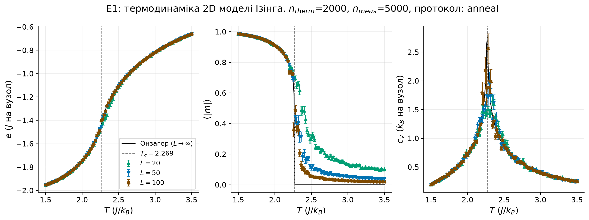
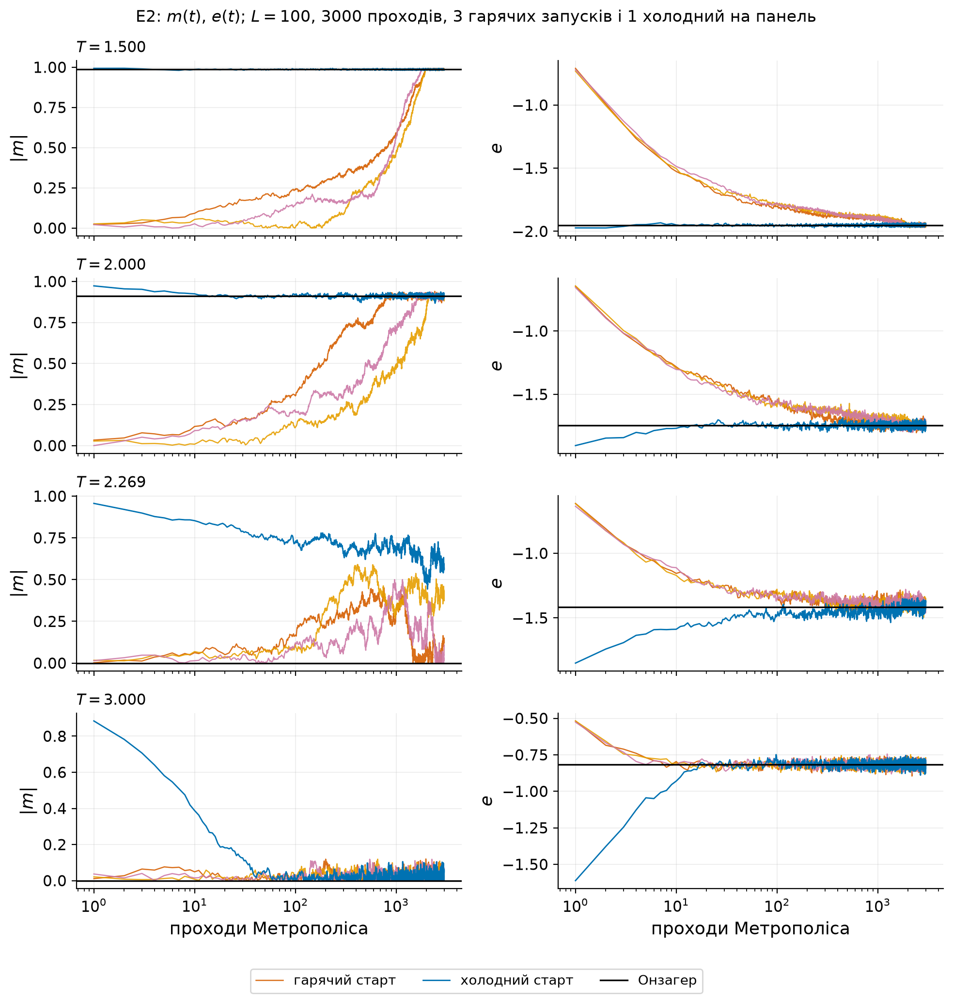
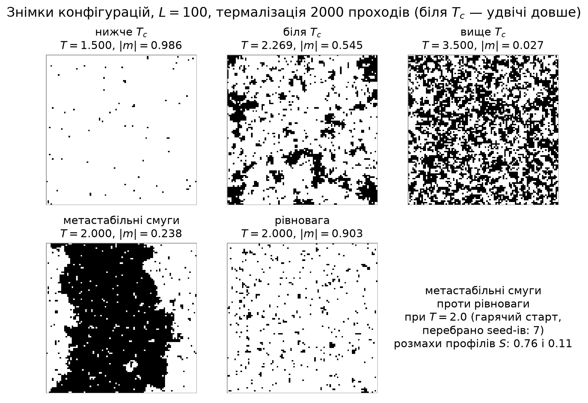

# 2D модель Ізінга, алгоритм Метрополіса (ДЗ1)

Ядро Метрополіса — Python + Numba (`src/ising/metropolis.py`).

| Рисунок | Скрипт | Що показує |
|---|---|---|
| `figures/full/e1_thermodynamics.png` | `experiments/e1_thermodynamics.py` | `e(T)`, `⟨|m|⟩(T)`, `c_V(T)` для `L = 20, 50, 100` + Онзагер |
| `figures/full/e2_trajectories.png` | `experiments/e2_thermalization.py` | `m(t)`, `e(t)` для гарячого й холодного старту |
| `figures/full/e6_snapshots.png` | `experiments/e6_snapshots.py` | знімки конфігурацій, у т.ч. застряглий смугастий стан |

## Запуск
#### Можна просто гугл колаб відкрити і не морочитись - [colab_demo_report](https://colab.research.google.com/drive/1hXdDoBxKzRo_ICsZdgRpPWqk8kmo9ZgX?usp=sharing), але він якийсь мега не зручний... [Нормальна версія](#graphs)
```bash
pip install -e .
python -m ising.run --preset quick               # хвилини
python -m ising.run --preset full                # повний розрахунок (довго)
python -m ising.run --preset full --plot-only    # лише перемалювати з results/full/*.npz
```

Один експеримент: `python -m experiments.e2_thermalization --preset quick`.
Дані (`results/<preset>/*.npz`) окремо від графіків (`figures/<preset>/*.png|pdf`).


<a id="graphs"></a>
## Тут те саме що в колабі

Тут суто загальне дослідження трьох параметрів для різних температур


Тут детально варіюю кількість проходів
Теплі кольори - рандомно розкинуті спіни (для всіх там 1/2)
Синій колір - всі стартують з +1
Не дуже зручно, але значення поділок для осі Х у самому низу


Тут, більше суто для очей, даю розкиди спінів по гратках за різних параметрів.

